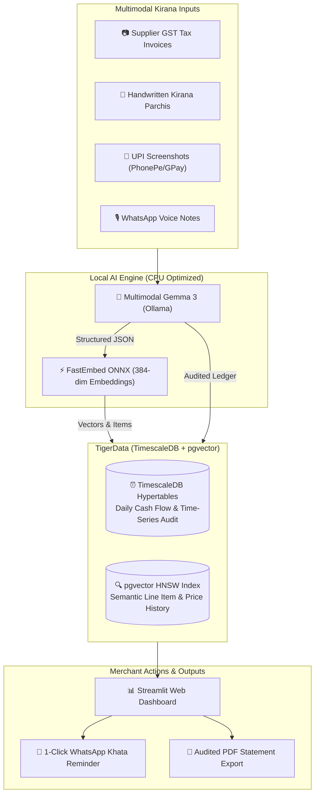

# 🏪 LedgerGone
### *Local WhatsApp Khata & Receipt Auditor for Kirana / Small Shops*


## 📌 The Problem
Indian Kirana (mom-and-pop grocery) and hardware shopkeepers receive dozens of supplier bills, handwritten paper slips (*parchis*), UPI screenshots (PhonePe, GPay), and WhatsApp voice notes (*"Sharma ji delivered 10 boxes soap for 4,500, paid 1,500 cash, 3,000 pending"*) every single day.

However, they face two major roadblocks:
1. **Manual Tallying Nightmare:** Sifting through scattered papers and WhatsApp chats at 11 PM after closing the store is exhausting and error-prone.
2. **The Cloud Privacy Dilemma:** Shopkeepers strictly refuse to upload sensitive tax invoices, profit margins, and supplier discounts to public cloud APIs due to fear of data leaks, competitor scrutiny, and tax audits.

---

## 💡 The Solution: LedgerGone
**LedgerGone** is a 100% local-first, privacy-preserving Khata and receipt auditor. It combines:
- **Multimodal Gemma 3:** Ingests receipt photos, handwritten parchis, and WhatsApp voice notes directly (no external OCR required) to extract line items, GST, paid amounts, and pending balances (*udhaar*).
- **TigerData (TimescaleDB + pgvector):** Stores time-series financial transactions in hypertables and vectors line items with pgvector for natural language inventory search.
- **WhatsApp Bill & Statement Generator:** Generates 1-click WhatsApp payment reminders with click-to-chat links and audited PDF statements.
- **CPU-Optimized:** Runs on standard laptops without requiring a dedicated GPU.

---

## 🏗️ System Architecture



---

## 🌟 Why Open Innovation Matters
Hacktoberfest Week 2 asks builders: *Why does open innovation matter for your side hustle?*

1. **Zero Recurring Cloud Token Costs:** Kirana stores operate on razor-thin 4–8% margins. Paying per-token cloud API bills destroys unit economics. With local open-weight Gemma 3 and TigerData, a developer can sell LedgerGone as a one-time purchase or ₹299/month local utility with zero API overhead.
2. **Absolute Privacy:** Invoices never leave the shopkeeper's laptop. Supplier discounts and cash receipts remain strictly offline.
3. **Offline Resilience:** Rural and semi-urban tier-2/3 Indian stores frequently experience internet outages. Local inference ensures uninterrupted daily bookkeeping.

---

## 🚀 Key Features

* **Multimodal Gemma 3 Extraction:** Directly reads images and audio transcripts without brittle OCR pipelines.
* **TigerData TimescaleDB Hypertables:** High-throughput time-bucketed daily cash flow, udhaar tracking, and credit analytics.
* **pgvector Semantic Search:** Search inventory with natural language (e.g., *"Find all cement bags bought last month"* or *"basmati rice rate history"*).
* **WhatsApp Deep Links:** Auto-formatted polite payment reminders in English/Hindi sent via `wa.me` in a single click.
* **Clean Printable PDF Khata:** Professional statements for supplier reconciliations.
* **Built-in Kirana Sample Presets:** Test instantly with sample handwritten parchis, hardware invoices, and voice notes.

---

## 🛠️ Tech Stack
- **Language:** Python 3.12+
- **Frontend / Dashboard:** Streamlit
- **AI Vision & Extraction:** Gemma 3 Multimodal (via Ollama)
- **Database:** TigerData (TimescaleDB PostgreSQL 18 + pgvector)
- **Embeddings:** FastEmbed (ONNX CPU Runtime, `BAAI/bge-small-en-v1.5`, 384 dimensions)
- **PDF Generation:** ReportLab
- **Package Manager:** `uv`

---

## 📦 Getting Started

### 1. Clone & Setup
```bash
git clone https://github.com/abhas20/LedgerGone.git
cd LedgerGone
```

### 2. Install Dependencies (via uv)
```bash
uv sync
```
*(Or standard pip: `pip install -r requirements.txt`)*

### 3. Configure Database
Ensure `.env` contains your TigerData TimescaleDB connection URL:
```env
DATABASE_URL=postgres://tsdbadmin:<password>@<host>:<port>/tsdb?sslmode=require
OLLAMA_BASE_URL=http://localhost:11434
GEMMA_MODEL=gemma3
```

### 4. Run the Dashboard
```bash
uv run streamlit run src/app.py
```
Open your browser at `http://localhost:8501`.

---

## 🐳 Running with Docker
```bash
docker compose up -d
```
Accessible at `http://localhost:8501`.

---

## 🏆 Hacktoberfest 2026 Compliance
- **Window:** Started & finished within the Week 2 window (Oct 12 – Oct 18, 2026).
- **Prompt:** Built with open-source AI at its core for the *Side Hustle* theme.
- **Sponsor Tracks:**
  - **Best Use of Gemma:** Uses Gemma 3 multimodal model for receipt vision and Hinglish voice note parsing.
  - **Best Use of Tiger Data:** Uses TimescaleDB hypertables for time-series cash flows and pgvector for semantic item search.

